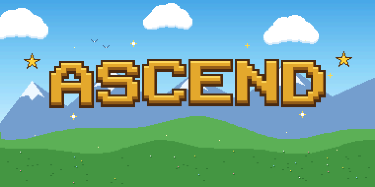
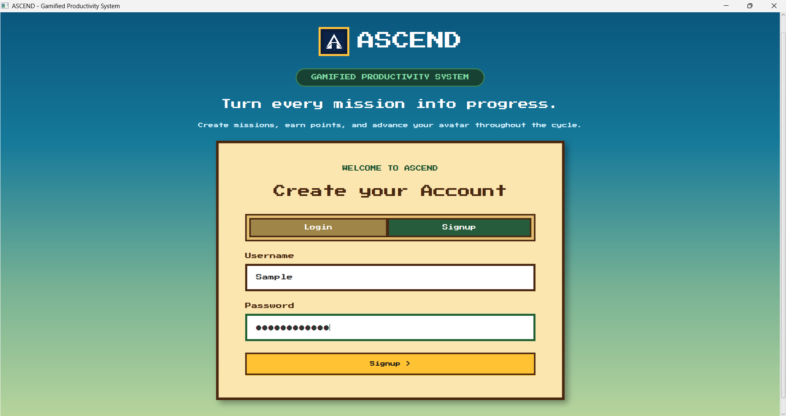
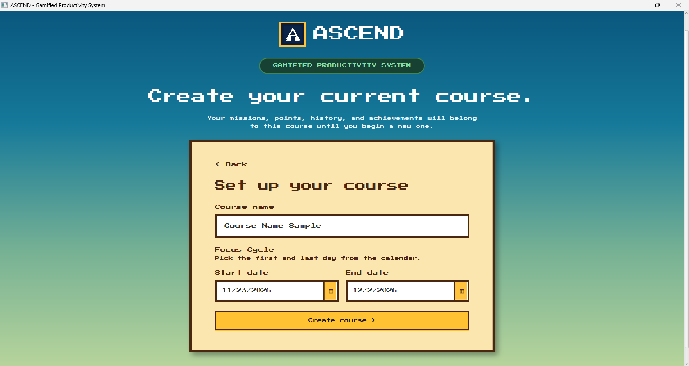
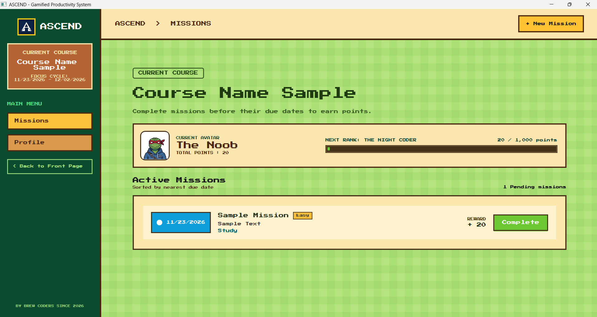
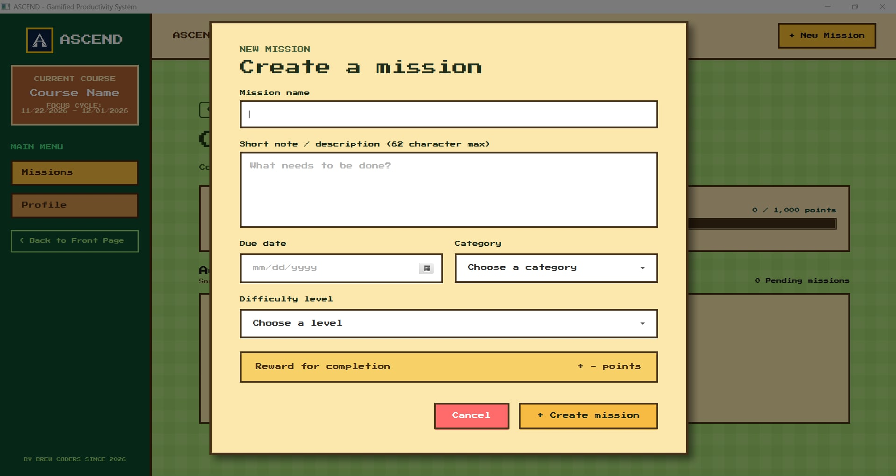
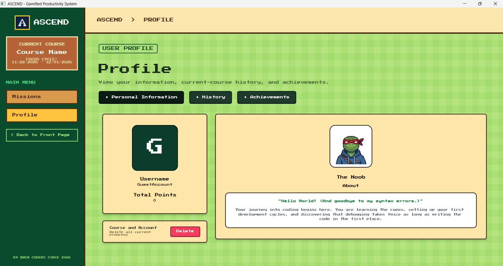
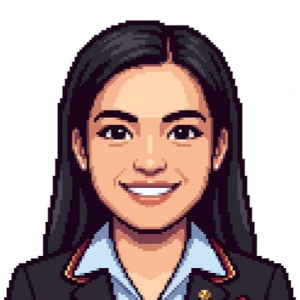

<p align="center">
  
</p>

<div align="center">
  <h1>🎮 ASCEND</h1>
  <h3>Advancing Skills through Challenges, Experiences, and Navigating Development</h3>
</div>

<p align="center">
  <strong>ASCEND</strong> is an offline, gamified Java desktop productivity application built for student programmers and aspiring developers. Designed with a retro pixel-art interface, ASCEND transforms daily coding tasks, coursework, and study goals into structured in-game <strong>Missions</strong>. By completing tasks before their deadlines, users earn experience points (XP), evolve their virtual developer avatars across four rank tiers, and unlock achievements within time-bound <strong>Focus Cycles</strong>—all without internet distractions.
</p>


## 💭 Overview

In **ASCEND**, consistency is your strongest weapon.

Learning programming requires daily hands-on practice, yet student programmers often struggle with burnout, procrastination, and unstructured study routines. Standard to-do lists and calendars track deadlines, but they lack immediate feedback and built-in motivation. **ASCEND** turns your coursework and personal coding builds into a rewarding progression loop.

### Main Features

| Feature | Description |
| :--- | :--- |
| **Account Registration and Authentication** | Manages user registration by capturing credentials, course details, and cycle target dates. Performs input validation, verifies login details, and initializes the starting user profile with a base avatar. |
| **Mission Management System** | Allows users to create, view, and update coding tasks with categories ( `Study` , `Build` , `Practice` ), difficulty ratings ( `Easy` : +20 pts, `Medium` : +50 pts, `Hard` : +70 pts), and target deadlines. Uses custom data sorting algorithms to organize missions by urgency and updates user points upon task completion or missed deadline. |
| **Avatar and Rank Progression** | Tracks accumulated points earned from completed missions to calculate user rank progression. Automatically updates player status across structured developer tiers, moving from entry level ( `The Noob` at 0 pts, `The Night Coder` at 1,000 pts, `The Grinder` at 2,000 pts) up to advanced rank milestones ( `The Wildcard` at 3,000 pts). |
| **Focus Cycle Reset System** | Manages user-defined goal intervals. Allows initiating a new study cycle, which securely resets active points, current avatar rank, and task history while archiving summary statistics for a fresh start. |
| **Profile and History Monitoring** | Generates a structured read-only display of user credentials, current rank status, unlocked achievements, and a log of completed or overdue missions within the active cycle. |


## 📦 OOP Concepts Applied

### 💊 Encapsulation

- **`User`** keeps all internal fields (`username`, `currentCourse`, `startingAvatar`, `missions`) `private` to protect account and course state integrity.
- All state mutations go through validated public methods (`createCourse()`, `addMission()`, `setMissions()`), and `getMissions()` returns a defensive copy (`new ArrayList<>(missions)`) so external callers cannot modify the internal list directly.

Example (`User.java`):

```java
public class User {
    private final String username;
    private CourseCycle currentCourse;
    private final Avatar startingAvatar;
    private final ArrayList<Mission> missions = new ArrayList<>();

    public User(String username) {
        if (username == null || !username.matches("[a-zA-Z0-9_]{3,30}")) {
            throw new IllegalArgumentException("Username must be 3-30 letters, numbers, or underscores.");
        }
        this.username = username;
        startingAvatar = new Noob();
    }

    public List<Mission> getMissions() { return new ArrayList<>(missions); }

    public void addMission(Mission mission) {
        if (!hasCourse()) {
            throw new IllegalStateException("Create a course before adding missions.");
        }
        if (mission == null) {
            throw new IllegalArgumentException("A mission is required.");
        }
        if (missions.contains(mission)) {
            throw new IllegalArgumentException("This mission is already stored.");
        }
        MissionOwnership.claim(mission, username);
        missions.add(mission);
    }
}
```

In this example:
- External classes cannot bypass course existence, null checks, duplicate checks, or ownership validation when adding missions.
- `getMissions()` returns a copy rather than exposing the backing `ArrayList`.

---

### 💖 Abstraction

- **`Avatar`** is an `abstract` class that defines the required contract (`getTitle()` and `getRequiredPoints()`) that every rank subclass must implement, while providing shared unlock evaluation logic via `isUnlocked(int points)`.
- Concrete rank subclasses (`Noob`, `NightCoder`, `Grinder`, `Wildcard`) extend `Avatar` and supply their own rank titles and XP thresholds.

Example (`Avatar.java`):

```java
// Abstraction: every avatar must provide these two details.
public abstract class Avatar {
    public abstract String getTitle();

    public abstract int getRequiredPoints();
    
    public boolean isUnlocked(int points) {
        return points >= getRequiredPoints();
    }
}
```

---

### 🔗 Inheritance

- Concrete mission types (`BuildMission`, `StudyMission`, `PracticeMission`) extend **`ParentMission`**, inheriting shared mission attributes (`name`, `notes`, `dueDate`, `difficulty`) and validation rules without duplicating code.
- Each subclass passes its category to `super(...)` and overrides `getCategory()`.

Example (`BuildMission.java`):

```java
/* Purpose: Represent a build mission using the shared mission rules.
 */
public class BuildMission extends ParentMission {

    public BuildMission(String name, String notes, LocalDate dueDate, String difficulty) {
        super(name, notes, dueDate, "Build", difficulty);
    }

    @Override
    public String getCategory() { return "Build"; }
}
```

---

### ✨ Polymorphism

- **`ProgressionService`** handles all four rank subclasses (`Noob`, `NightCoder`, `Grinder`, `Wildcard`) uniformly through the abstract **`Avatar`** type.
- `currentAvatar(int points)` returns an `Avatar` reference whose concrete subclass is determined dynamically at runtime, while `achievements(int points)` stores all four subclasses inside an `Avatar[]` array to evaluate rank unlocks polymorphically.

Example (`ProgressionService.java`):

```java
// Purpose: Determine the current avatar based on total points earned.
public static Avatar currentAvatar(int points) {
    if (points >= 3000) return new Wildcard();
    if (points >= 2000) return new Grinder();
    if (points >= 1000) return new NightCoder();
    return new Noob();
}

// Purpose: Determine the achievements unlocked based on total points earned.
public static List<Achievement> achievements(int points) {
    Avatar[] avatars = {new Noob(), new NightCoder(), new Grinder(), new Wildcard()};
    List<Achievement> results = new ArrayList<>();
    for (int i = 0; i < avatars.length; i++) results.add(new Achievement(avatars[i], points));
    return results;
}
```

In this example:
- `Achievement` interacts with each element in `Avatar[]` through the base `Avatar` reference without needing separate logic per rank class.


## 🛠️ Program Structure

```text
ASCEND/
├── src/
│   ├── main/
│   │   ├── java/com/brewcoders/ascend/
│   │   │   ├── backend/
│   │   │   │   ├── model/
│   │   │   │   │   ├── avatar/
│   │   │   │   │   │   ├── Avatar.java
│   │   │   │   │   │   ├── Grinder.java
│   │   │   │   │   │   ├── NightCoder.java
│   │   │   │   │   │   ├── Noob.java
│   │   │   │   │   │   └── Wildcard.java
│   │   │   │   │   ├── mission/
│   │   │   │   │   │   ├── BuildMission.java
│   │   │   │   │   │   ├── ParentMission.java
│   │   │   │   │   │   ├── PracticeMission.java
│   │   │   │   │   │   └── StudyMission.java
│   │   │   │   │   ├── Account.java
│   │   │   │   │   ├── Achievement.java
│   │   │   │   │   ├── CourseCycle.java
│   │   │   │   │   └── User.java
│   │   │   │   ├── security/
│   │   │   │   │   └── Credential.java
│   │   │   │   ├── service/
│   │   │   │   │   ├── AuthService.java
│   │   │   │   │   ├── MissionFactory.java
│   │   │   │   │   ├── MissionLifecycle.java
│   │   │   │   │   ├── MissionOwnership.java
│   │   │   │   │   ├── MissionRules.java
│   │   │   │   │   ├── MissionService.java
│   │   │   │   │   ├── MissionSorter.java
│   │   │   │   │   ├── MissionValidation.java
│   │   │   │   │   └── ProgressionService.java
│   │   │   │   └── storage/
│   │   │   │       ├── AccountStore.java
│   │   │   │       └── MissionStorage.java
│   │   │   ├── controller/
│   │   │   │   └── MissionManager.java
│   │   │   ├── model/
│   │   │   │   └── Mission.java
│   │   │   ├── view/
│   │   │   │   ├── auth/
│   │   │   │   │   ├── LoginView.java
│   │   │   │   │   ├── SignupCourseView.java
│   │   │   │   │   └── SignupCredentialsView.java
│   │   │   │   ├── missions/
│   │   │   │   │   ├── CreateMissionModal.java
│   │   │   │   │   └── MissionsView.java
│   │   │   │   ├── navigation/
│   │   │   │   │   ├── MainLayoutView.java
│   │   │   │   │   └── SidebarView.java
│   │   │   │   └── profile/
│   │   │   │       ├── AchievementsView.java
│   │   │   │       ├── HistoryView.java
│   │   │   │       ├── PersonalInfoView.java
│   │   │   │       └── ProfileMainView.java
│   │   │   └── MainApp.java
│   │   └── resources/
│   │       ├── css/
│   │       │   └── styles.css
│   │       ├── fonts/
│   │       │   └── PressStart2P-Regular.ttf
│   │       └── images/
│   │           ├── avatars/
│   │           └── logo.png
│   └── test/
│       └── java/
├── .gitignore
├── pom.xml
└── README.md
```

### Main Roles:

- **`com.brewcoders.ascend.MainApp` & `view/`**
  - Entry point (`MainApp.java`) launching the JavaFX stage with retro pixel styling (`styles.css`, `PressStart2P-Regular.ttf`, `logo.png`).
  - Organized into modular view packages: `auth/` (`LoginView`, `SignupCredentialsView`, `SignupCourseView`), `navigation/` (`MainLayoutView`, `SidebarView`), `missions/` (`MissionsView`, `CreateMissionModal`), and `profile/` (`ProfileMainView`, `PersonalInfoView`, `HistoryView`, `AchievementsView`).
- **`com.brewcoders.ascend.controller.MissionManager`**
  - Singleton facade connecting all JavaFX views to the backend services while keeping session and UI state synchronized.
- **`com.brewcoders.ascend.backend.model` & `model/Mission.java`**
  - Core domain entities: `User`, `Account`, `CourseCycle`, `Achievement`, and `Mission`.
  - OOP hierarchies: `avatar/` (`Avatar` base class extended by `Noob`, `NightCoder`, `Grinder`, `Wildcard`) and `mission/` (`ParentMission` base class extended by `BuildMission`, `PracticeMission`, `StudyMission`).
- **`com.brewcoders.ascend.backend.service`**
  - `AuthService` & `ProgressionService` handle login/registration flows, XP totals, avatar rank evaluation, and achievement unlocks.
  - `MissionService`, `MissionFactory`, `MissionLifecycle`, `MissionOwnership`, `MissionRules`, `MissionSorter`, and `MissionValidation` enforce task rules, ownership checks, due-date sorting, and status transitions.
- **`com.brewcoders.ascend.backend.security` & `storage`**
  - `Credential` manages secure password hashing and verification, while `AccountStore` and `MissionStorage` persist user accounts and missions locally.


## 🖥️ How to Run the Program

### Prerequisites:

- **Java Development Kit (JDK) 17+** installed and added to your system `PATH`
- **Apache Maven** installed (or the Maven extension enabled in VS Code / IntelliJ IDEA)

### Step-by-step:

1. **Clone the repository from GitHub:**
   ```bash
   git clone https://github.com/lancebanaag14-ui/ASCEND.git
   ```
2. **Open `pom.xml` in your project root, launch a New Terminal, and run:**
   ```bash
   mvn javafx:run
   ```
   *(Optional: Run `mvn clean javafx:run` for a fresh build.)*
3. **Create an Account & Start a Focus Cycle:**
   - Switch to the **Signup** tab, enter a username (3–30 alphanumeric/underscore characters) and password (8–64 characters), and click **Signup >**.
   - Enter your **Course Name**, choose your **Focus Cycle** start and end dates, and click **Create course >**.
   - Click **+ New Mission** to create tasks, complete them before their deadlines to earn XP, and monitor your rank unlocks under **Profile**.

### Notes:
- All user accounts, missions, and cycle history are stored offline in local `.dat` files—no internet connection is required.
- Overdue missions are automatically moved to your **History** log whenever the dashboard refreshes.


## 👾 Sample Output

| Login Screen | Signup Screen |
| :---: | :---: |
|  |  |

| Course & Focus Cycle Setup | Active Missions Dashboard |
| :---: | :---: |
|  |  |

| Create a Mission Modal | Profile — Personal Information |
| :---: | :---: |
|  |  |

| Profile — Mission History | Profile — Achievements |
| :---: | :---: |
|  |  |


## 📝 Other Sections

### Known Limitations

1. **Online Synchronization and Cloud Storage:** The application operates strictly as an offline desktop tool, meaning user data, mission logs, and progress are stored locally and will not synchronize across multiple devices or cloud databases.
2. **Multiplayer or Social Collaboration:** The system does not support online leaderboards, peer-to-peer task sharing, friends lists, or direct communication between users.
3. **Automated Integrated Development Environment (IDE) Code Tracking:** The application does not automatically monitor or compile a user's local code files; mission completions rely on manual user submission and task confirmation.
4. **Third-Party Calendar and Notification Integration:** The system will not send external email alerts, mobile push notifications, or synchronize with external calendar services like Google Calendar or Outlook.
5. **Real-Money In-App Transactions:** Avatar ranks, rewards, and customization options are unlocked exclusively through in-game experience points earned via task completions and cannot be purchased.

### Future Improvements

* **Multi-Course Switching:** Allow users to maintain multiple active courses simultaneously rather than resetting progress when starting a new course.
* **Archived Cycle Analytics:** Add charts and summary statistics comparing productivity across past completed Focus Cycles.
* **Custom Avatar Cosmetics & Sound Effects:** Introduce unlockable retro pixel themes, badges, and chiptune audio feedback upon mission completion and rank-ups.
* **Optional Cloud Backup:** Add JSON/SQLite export and import functionality so users can back up or transfer their save files between computers.


## ✨ Authors & Credits

<table align="center">
  <tr>
    <td align="center" width="220">
      <br>
      <strong>Mheven B. Francisco</strong><br>
      Project Leader &<br>Front-End Developer<br><br>
      <a href="https://github.com/mhevenfrancisco">
        
      </a>
    </td>
    <td align="center" width="220">
      <br>
      <strong>Nadine C. Evangelio</strong><br>
      System Design &<br>Front-End Developer<br><br>
      <a href="https://github.com/25-03737-Evangelio">
        
      </a>
    </td>
    <td align="center" width="220">
      <br>
      <strong>Lance Vhincent M. Banaag</strong><br>
      Lead Back-End<br>Programmer<br><br>
      <a href="https://github.com/lancebanaag14-ui">
        
      </a>
    </td>
  </tr>
</table>

## 🙏 Acknowledgement

We would like to express our heartfelt gratitude to our Object-Oriented Programming professor, **Ma'am Fatima Marie Agdon**, for her continuous guidance, patience, and valuable feedback throughout the development of **ASCEND**. We are also deeply thankful to God, our families, and everyone who supported **Team Brew Coders** in bringing this project to life. 💛


<h2 align="center">💖 Thank You for Reading!</h2>

<p align="center">
  Thank you for checking out <strong>ASCEND — Advancing Skills through Challenges, Experiences, and Navigating Development</strong>.<br>
  We hope it helps student programmers stay consistent, beat procrastination, and turn every mission into measurable progress.<br>
  Your support means a lot and motivates <strong>Team Brew Coders</strong> to keep building! 💛
</p>

<div align="center">
  <small>
    <strong>DISCLAIMER</strong><br>
    This project is created for <strong>educational purposes</strong> under the <strong>Object-Oriented Programming</strong> course.<br>
    © 2026 Team Brew Coders. All rights reserved.
  </small>
</div>