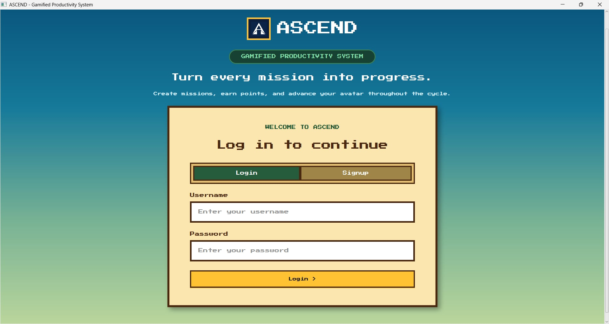
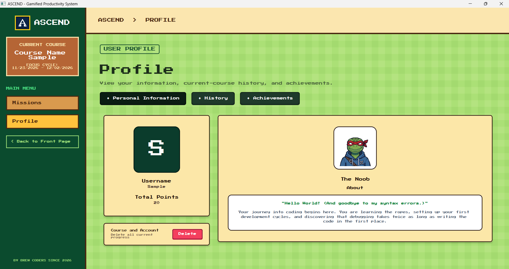
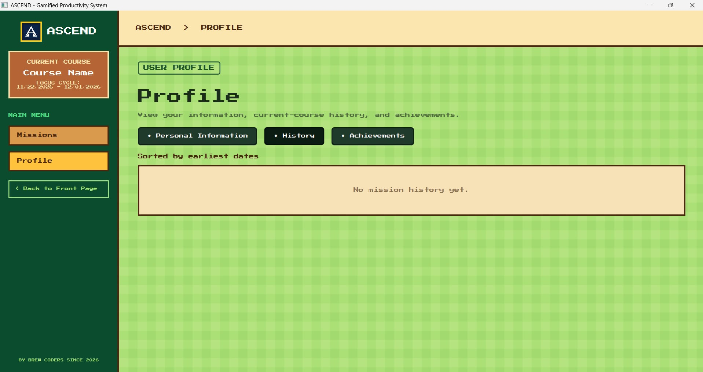

<div align="center">
  <h3>ASCEND</h3>
  <p><strong>Advancing Skills through Challenges, Experiences, and Navigating Development</strong></p>
</div>

## Project Description
**ASCEND (Advancing Skills through Challenges, Experiences, and Navigating Development)** is an offline, gamified Java desktop productivity application built for student programmers and aspiring developers. Designed with a retro pixel-art interface, ASCEND transforms daily coding tasks, coursework, and study goals into structured in-game "Missions". By completing tasks before their deadlines, users earn experience points (XP), level up their virtual developer avatars, and unlock achievement ranks within time-bound Focus Cycles.


## Problem Being Addressed
Learning programming requires consistent, hands-on practice, yet student programmers and aspiring developers frequently struggle to maintain focus and structured study habits. Standard productivity tools, such as basic to-do lists and generic calendars, are often ineffective because they do not offer immediate feedback or display personal growth. Consequently, learners preparing for academic coursework, technical examinations, and software projects often lose motivation and abandon their study routines. ASCEND: Advancing Skills through Challenges, Experiences & Navigating Development addresses this challenge by converting daily coding tasks into a structured, offline Java desktop application. Operating offline ensures a distraction-free environment while allowing users to organize goals into actionable coding "Missions". 


## Project Objectives

### General Objective
To develop an offline Java-based application that provides programmers and students with a gamified productivity system to track coding tasks, manage deadlines, and build consistent habits.

### Specific Objectives
The project aims to:
1. Create a secure user authentication system for sign-up and login that manages profile data and assigns an initial starter avatar.
2. Implement a mission management module allowing users to create, categorize, and complete tasks with custom difficulty levels to earn experience points.
3. Build an avatar progression model that tracks point milestones and automatically unlocks higher ranks and rewards.
4. Establish a Focus Cycle mechanism to track productivity sessions within defined time-frames and support system resets for new study cycles.
5. Implement input validation and robust exception handling to ensure continuous system stability during file interactions and user input.
6. Apply Object-Oriented Programming principles, including Encapsulation, Inheritance, Polymorphism, and Abstraction, to create a maintainable, modular software architecture.


## Target Users

| Target User | How They Will Use the System |
| :--- | :--- |
| **Student Programmers** | Students will use the application to organize coursework, manage programming assignment deadlines, and structure examination review. Completing academic coding missions on time yields experience points, helping them build consistent study habits and track assignment progress. |
| **Aspiring Developers** | Independent learners will use the system to schedule personal software projects and execute daily practice sessions. Setting milestone goals within Focus Cycles enables them to stay accountable, monitor skill growth, and advance avatar ranks independently. |


## Main Features

| Feature | Description |
| :--- | :--- |
| **Account Registration and Authentication** | Manages user registration by capturing credentials, course details, and cycle target dates. Performs input validation, verifies login details, and initializes the starting user profile with a base avatar. |
| **Mission Management System** | Allows users to create, view, and update coding tasks with categories (`Study`, `Build`, `Practice`), difficulty ratings (`Easy`: +20 pts, `Medium`: +50 pts, `Hard`: +70 pts), and target deadlines. Uses custom data sorting algorithms to organize missions by urgency and updates user points upon task completion or missed deadline. |
| **Avatar and Rank Progression** | Tracks accumulated points earned from completed missions to calculate user rank progression. Automatically updates player status across structured developer tiers, moving from entry level (`The Noob` at 0 pts, `The Night Coder` at 1,000 pts, `The Grinder` at 2,000 pts) up to advanced rank milestones (`The Wildcard` at 3,000 pts). |
| **Focus Cycle Reset System** | Manages user-defined goal intervals. Allows initiating a new study cycle, which securely resets active points, current avatar rank, and task history while archiving summary statistics for a fresh start. |
| **Profile and History Monitoring** | Generates a structured read-only display of user credentials, current rank status, unlocked achievements, and a log of completed or overdue missions within the active cycle. |


## Technologies Used
- **Language:** `Java (JDK 17+)`
- **GUI Framework:** `JavaFX 21` (Custom CSS styling, `Canvas` pixel grid rendering, `TextFormatter` input filters)
- **Build & Dependency Management:** `Apache Maven` (`pom.xml`)
- **Storage & Security:** `Java NIO` / Binary Streams (`.dat` local persistence with backup recovery) & `PBKDF2WithHmacSHA256` password hashing
- **Design & Version Control:** Figma (Wireframes & User Flow), PlantUML / Draw.io (UML Class Diagram), Git & GitHub, Visual Studio Code


## Team Members and Roles

| Member | Role | Assigned Tasks |
| :--- | :--- | :--- |
| **Banaag, Lance Vhincent M.** | Lead Programmer | GitHub repository setup, backend architecture, OOP models, service logic, security hashing, and local `.dat` storage persistence. |
| **Evangelio, Nadine C.** | System / Design Lead | UML class diagrams, system flowcharts, front-end debugging, and input validation / exception handling. |
| **Francisco, Mheven B.** | Project Leader / Documentation | UI/UX wireframing, JavaFX & Maven setup in VS Code, responsive view implementation, and project documentation. |


## OOP Concepts Demonstrated

| OOP Concept | How It Will Be Used |
| :--- | :--- |
| **Classes and Objects** | Classes are the blueprints that describe the parts of the app such as `User`, `CourseCycle`, `Mission`, `Avatar`, and `Achievement`. Objects are the actual data created from these blueprints, so each new user creates their own object, which holds each individual's own data. |
| **Methods** | Methods are the actions the app can perform, such as signing up, logging in, creating and completing missions, checking deadlines, computing points, unlocking avatars, and resetting the cycle. Each method does one job and helps in returning values. |
| **Encapsulation** | All important data of the user, such as the `username`, `password`, `points`, and `avatar`, is `private` and every value is validated before it is stored. Other parts of the app can read data only through methods that return a value or change it through controlled methods, and the password has no getter, so it can only be checked for a match. |
| **Inheritance** | Inheritance is used in `Mission` as the parent of `PracticeMission`, `BuildMission`, and `StudyMission`, so the name, notes, due date, difficulty, and status are written once in the parent instead of three times. `Avatar` is the parent of `Noob`, `NightCoder`, `Grinder`, and `Wildcard`, which share the same structure and differ only in their title, required points, and motto. The child classes are kept small because they differ only in their category or rank details, and the rest is reused from the parent. |
| **Polymorphism** | The app treats all missions the same way, but each type responds in its own way. When the mission is completed, the correct behavior runs for that mission type and points change with the difficulty. |
| **Abstraction** | Abstraction serves as what every mission and avatar must be able to do without saying how. The parent classes list the required actions and every child class must supply its own version in order for the program to provide correct data on its supposed category. |
| **Exception Handling** | This keeps the app from crashing. When the app encounters a problem such as wrong credentials, empty fields, invalid dates, completing a failed mission, action after the cycle ended, and wrong inputs such as in logging in or entering data, it shows a clear message, then asks the user to try again in order for the app to continue running. |
| **Arrays / Data Handling** | Lists (`ArrayList`) store active, completed, and failed missions for historical tracking. Every time the menu is displayed, the app reviews the list to move overdue missions to the history as failed, alongside all currently active missions. |


## Instructions for Running the Program

### Prerequisites
- **Java Development Kit (JDK) 17** or higher installed and added to your system `PATH`.
- **Apache Maven** installed (or use the Maven extension in VS Code / IntelliJ IDEA).

### Steps to Run
1. Clone the repository from GitHub ([https://github.com/lancebanaag14-ui/ASCEND.git](https://github.com/lancebanaag14-ui/ASCEND.git)) and open the project folder in your IDE (e.g., VS Code).
2. Open `pom.xml` (or ensure your terminal is inside the project's root directory where `pom.xml` is located), open a **New Terminal**, and run:
   ```bash
   mvn javafx:run
   ```
3. On the launch screen, switch to the **Signup** tab, enter a valid username (3–30 characters) and password (8–64 characters), and click **Signup >**.
4. Enter your **Course Name** and pick your **Focus Cycle** start and end dates, then click **Create course >**.
5. Click **+ New Mission** to add tasks, complete them before their due dates to earn points, and check your rank progress under the **Profile** tab.


## Sample Screenshots

| Screen | Preview |
| :--- | :---: |
| **Login Screen** |  |
| **Signup Screen** |  |
| **Course & Focus Cycle Setup** |  |
| **Active Missions Dashboard** |  |
| **Create a Mission Modal** |  |
| **Profile — Personal Information** |  |
| **Profile — Mission History** |  |
| **Profile — Achievements** |  |


## Known Limitations
1. **Online Synchronization and Cloud Storage:** The application operates strictly as an offline desktop tool, meaning user data, mission logs, and progress are stored locally and will not synchronize across multiple devices or cloud databases.
2. **Multiplayer or Social Collaboration:** The system does not support online leaderboards, peer-to-peer task sharing, friends lists, or direct communication between users.
3. **Automated Integrated Development Environment (IDE) Code Tracking:** The application does not automatically monitor or compile a user's local code files; mission completions rely on manual user submission and task confirmation.
4. **Third-Party Calendar and Notification Integration:** The system will not send external email alerts, mobile push notifications, or synchronize with external calendar services like Google Calendar or Outlook.
5. **Real-Money In-App Transactions:** Avatar ranks, rewards, and customization options are unlocked exclusively through in-game experience points earned via task completions and cannot be purchased.


## Future Improvements
- **Multi-Course Switching:** Allow users to maintain multiple active courses simultaneously rather than resetting progress when starting a new course.
- **Archived Cycle Analytics:** Add charts and summary statistics comparing productivity across past completed Focus Cycles.
- **Custom Avatar Cosmetics & Sound Effects:** Introduce unlockable retro pixel themes, badges, and chiptune audio feedback upon mission completion and rank-ups.
- **Optional Cloud Backup:** Add JSON/SQLite export and import functionality so users can back up or transfer their save files between computers.


## Project Contributors
- **Banaag, Lance Vhincent M.** ([@lancebanaag14-ui](https://github.com/lancebanaag14-ui))
- **Evangelio, Nadine C.** ([@25-03737-Evangelio](https://github.com/25-03737-Evangelio))
- **Francisco, Mheven B.** ([@mhevenfrancisco](https://github.com/mhevenfrancisco))
````[cite: 2, 3, 4, 5, 6, 10, 32, 33, 34, 35, 36, 37, 38, 41, 42, 43, 44, 45, 46]